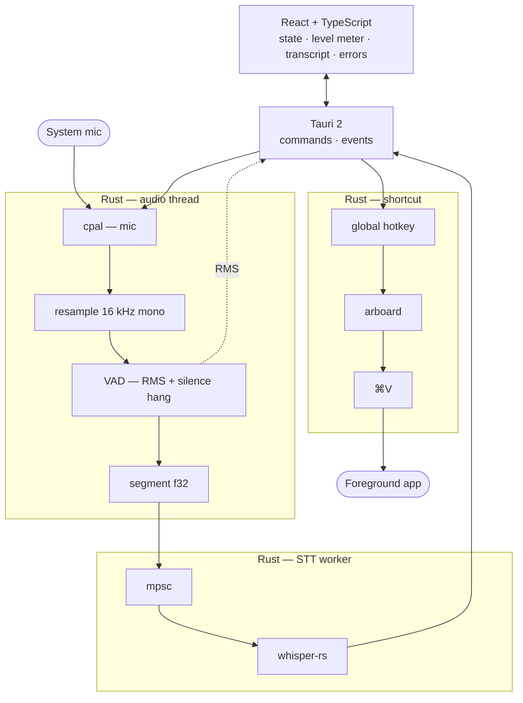

# Implementation plan — `local-dictate`

Living checklist for the take-home. Safe to commit (no private briefing text).  
Detailed assignment notes stay local in gitignored files.

**Stack (locked):** Tauri 2 · Rust · React · TypeScript · Vite 8 · macOS first  
**Inspiration (product only):** [Voicely / Everlast community](https://www.voicely.de/en/everlast-community)

---

## Goal

Native desktop mini-app: capture microphone audio until silence, transcribe **locally** (whisper.cpp via Rust bindings), insert text into the **foreground application** via a **global shortcut**. UI is status/feedback only — capture and paste are **Rust / OS APIs**, not browser MediaRecorder or web-only paste.

---

## Architecture (target)

Vertical layout so the diagram stays **narrow** and renders larger in preview / GitHub.

**Threading:** `cpal` callback must **never** block on Whisper; segments go to STT via **`mpsc`** on a worker thread.  
**Acceptance:** paste works in **TextEdit / Notes**, not only in the webview.

---

## Decisions

| Topic | Choice | Notes |
|-------|--------|--------|
| Platform | macOS | Windows documented as untested unless time allows |
| STT | `whisper-rs` + ggml on disk | Model **not** in git; download script |
| Model size | `base` (default) | `small` as optional upgrade in README |
| VAD | RMS + silence hang + max duration | Default RMS **0.008** in code; user threshold at **#8** (see milestones) |
| Paste | Clipboard + simulated ⌘V | Accessibility permission likely required |
| UI | Small window + meter | Minimal HTML/CSS for milestones 4–9; **shadcn** + Tailwind at **#10**; tray deferred |

**Open (pick during build):**

- [ ] Shortcut scheme: one key vs record / paste split  
- [ ] Assignment receipt date in README (deadline line)

---

## Milestones & commits

Each step should compile or be an obvious WIP milestone.

| # | Milestone | Status |
|---|-----------|--------|
| 0 | Repo scaffold, `.gitignore`, license (MIT) | done (pre-template) |
| 1 | Tauri 2 + React + dev/build working | done |
| 2 | `cpal` capture + RMS → UI level meter | done |
| 3 | `cpal` input device list + UI selector (avoid wrong default mic) | done |
| 4 | Resample 16 kHz mono + silence segmentation | done |
| 5 | Debug: session segment buffer + cpal replay after stop | done |
| 6 | `whisper-rs` + model download script | todo |
| 7 | End-to-end: silence → transcript in app state | todo |
| 8 | User setting: VAD RMS threshold (persist; optional hang later) | todo |
| 9 | Global shortcut + paste (TextEdit / Notes test) | todo |
| 10 | Tailwind + shadcn foundation (Button, Select, Alert, …) | todo |
| 11 | UI state machine + error / permission hints | todo |
| 12 | README (build, model, shortcuts, architecture) + `docs/ai-usage.md` | todo |
| 13 | Release build (`pnpm tauri build`) + known limitations | todo |

---

## macOS permissions (document in README)

- Microphone — when using `cpal`  
- Accessibility — likely for synthetic paste  

---

## Acceptance checks

- [ ] Speak → silence → local transcript (no cloud)  
- [ ] Global shortcut inserts into **another** app (e.g. TextEdit)  
- [ ] Explain: sample rate, buffers, VAD constants, ownership of audio buffer, paste path  
- [ ] `cargo check` / `pnpm tauri build` clean on a fresh clone (with model download steps)

---

## Tooling notes

- **Vite 8 + pnpm:** explicit `@rolldown/binding-darwin-arm64` pinned to match Vite’s Rolldown version  
- **Node:** prefer 22.12+ (Vite 8 warns on 22.11)  
- Private briefings: `ASSIGNMENT.md`, `HANDOFF.md` (gitignored)

---

## After submission

- Replace this file’s checklist with “Implemented” summary in README or archive section if desired  
- Keep commit history granular for live code review
