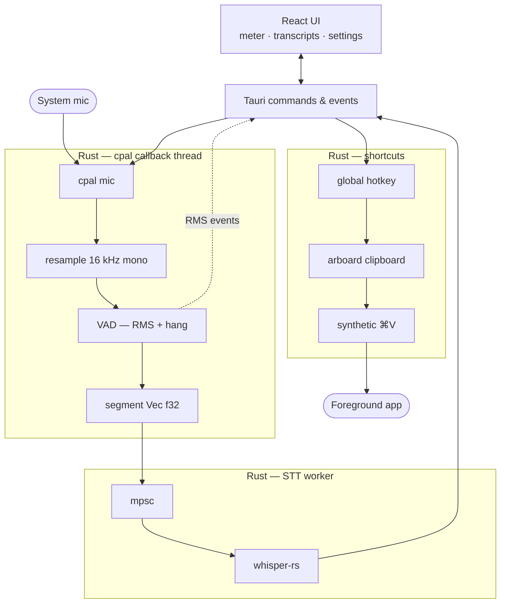

# local-dictate

Native **macOS** dictation mini-app: microphone capture → voice-activity segmentation → **local** [whisper.cpp](https://github.com/ggerganov/whisper.cpp) (via [whisper-rs](https://github.com/tazz4843/whisper-rs)) → paste into the **foreground app** with global shortcuts. Built with **Tauri 2**, **Rust**, and **React / TypeScript**.

Implementation log and milestone checklist: [`PLAN.md`](./PLAN.md).  
How AI tools were used: [`docs/ai-usage.md`](./docs/ai-usage.md).

---

## What it does

1. **Start monitoring** — `cpal` streams from the selected input device; the UI shows an RMS level meter.
2. **Speak and pause** — audio is resampled to **16 kHz mono**; a VAD ends each phrase after trailing silence.
3. **Transcribe** — closed segments are sent over an **`mpsc` channel** to a dedicated Whisper worker thread (the `cpal` callback never blocks on inference).
4. **Paste** — global shortcuts copy transcript text to the clipboard and post a synthetic **⌘V** (macOS **Accessibility**). Each finished segment is also copied to the clipboard automatically so you can paste manually if needed.

Audio capture, segmentation, STT, clipboard, and synthetic keys run in **Rust / OS APIs**, not in the browser.

---

## Requirements

| Tool | Notes |
| --- | --- |
| **macOS** | Primary platform; Windows/Linux paths exist for paste but are **untested**. |
| [Rust](https://rustup.rs/) | Stable toolchain (`cargo` for the Tauri backend). |
| [Node.js](https://nodejs.org/) | **22.12+** recommended (Vite 8 warns on older 22.x). |
| [pnpm](https://pnpm.io/) | Package manager for the frontend. |

---

## Quick start

```bash
git clone https://github.com/Jan-Eckerlein/local-dictate.git
cd local-dictate
pnpm install

# Speech model (~150 MB for base) — not in git
pnpm download-model

# Dev app (webview + hot reload)
pnpm tauri dev
```

**First run:** allow **Microphone** when prompted. For global paste into TextEdit, Notes, Cursor, etc., enable **Accessibility** for the app (or **Terminal** / **Cursor** when running `pnpm tauri dev`).

---

## Whisper model

Models are **not** committed. From the repo root:

```bash
pnpm download-model
```

| Item | Default |
| --- | --- |
| File | `models/ggml-base.bin` |
| Source | [ggerganov/whisper.cpp on Hugging Face](https://huggingface.co/ggerganov/whisper.cpp) |

Other sizes (download only; UI model picker planned):

```bash
WHISPER_MODEL=ggml-small.bin pnpm download-model
```

**Runtime override** (absolute path):

```bash
export LOCAL_DICTATE_WHISPER_MODEL=/path/to/ggml-base.bin
pnpm tauri dev
```

---

## Usage

1. Pick a microphone (if several are listed).
2. Adjust **VAD sensitivity** and **Whisper language** (auto / German / English) — stored in app data (see [Settings](#settings)).
3. **Start monitoring**, speak in short phrases, pause between them.
4. Focus another app and use a paste shortcut (or the UI buttons).

### Global paste shortcuts

| Shortcut | Action |
| --- | --- |
| **⌘⇧V** | Paste the **last** transcribed segment |
| **⌘⇧B** | Paste **new** segments since the last batch paste (no-op → info toast if nothing new) |
| **⌘⇧A** | Paste **all** segments in the session (newline-separated) |

Paste requires **Accessibility** (trusted process + synthetic ⌘V). Without it, use the text already on the clipboard after each segment completes.

---

## macOS permissions

| Permission | Why |
| --- | --- |
| **Microphone** | `cpal` input capture |
| **Accessibility** | Synthetic **⌘V** into other applications (`CGEvent` on macOS) |

The app can open the relevant System Settings panes from toasts (mic / accessibility).

---

## Build (release)

```bash
pnpm download-model   # if not already done
pnpm tauri build
```

Artifacts land under `src-tauri/target/release/bundle/` (`.app` and `.dmg` on Apple Silicon).

**macOS minimum:** 11.0 (set in `tauri.conf.json` and `src-tauri/.cargo/config.toml` so whisper.cpp can compile with C++17 `std::filesystem`).

On a **fresh clone**, run `pnpm install`, download the model, and ensure Xcode CLI tools / Rust are installed before building. **CI workflow artifacts** are unsigned smoke builds without the model; **tagged GitHub Releases** download the model during the workflow and bundle `ggml-base.bin` inside the app.

### CI

GitHub Actions on every push/PR to `main`:

| Job | Runner | What |
| --- | --- | --- |
| **Frontend** | `ubuntu-latest` | `pnpm build` (TypeScript + Vite) |
| **macOS release** | `macos-latest` | `pnpm tauri build` (unsigned bundle; DMG/app uploaded as artifacts) |

Workflow: [`.github/workflows/ci.yml`](.github/workflows/ci.yml).

### GitHub Releases (tagged builds only)

CI on `main` / PRs **does not** create a Release. A downloadable DMG is published only when you push a **version tag**:

```bash
git checkout main
git pull
git tag v0.1.0
git push origin v0.1.0
```

That runs [`.github/workflows/release.yml`](.github/workflows/release.yml) and attaches the macOS `.dmg` to the GitHub **Release** for that tag. Tags like `v0.1.0-rc.1` are marked **pre-release**.

Tagged releases **include** `ggml-base.bin` in the app bundle (~150 MB DMG). Dev/CI artifacts do not.

**Unsigned DMG from GitHub:** if macOS says the app is “damaged”, clear quarantine after install: `xattr -cr /Applications/local-dictate.app` (or right‑click → Open once).

---

## Architecture



**Threading:** the `cpal` stream callback only resamples, runs VAD, and enqueues work. Whisper runs on a **worker thread**; results arrive as `transcript-ready` events. Session audio `Vec<f32>` segments are owned in `AudioMonitorState` and cloned for the STT job.

**Paste path:** `TranscriptBuffer` holds per-segment text → `paste_text` writes **arboard** → short delay → **CGEvent** Command+V on macOS (`paste.rs`).

**Key Rust modules:** `audio.rs`, `segment.rs`, `stt.rs`, `stt_worker.rs`, `paste.rs`, `transcript_buffer.rs`, `settings.rs`.

---

## VAD & STT tuning

Constants live in `src-tauri/src/segment.rs` (defaults; VAD threshold is overridable in settings):

| Constant | Default | Role |
| --- | --- | --- |
| `WHISPER_SAMPLE_RATE` | 16 000 Hz | Whisper input rate after resample |
| `VAD_RMS_THRESHOLD` | `0.008` | Frame RMS above this counts as speech |
| `VAD_SILENCE_HANG_MS` | 700 ms | Trailing silence before closing a segment |
| `VAD_MAX_SEGMENT_MS` | 30 000 ms | Hard cap per utterance |
| `VAD_MIN_SEGMENT_MS` | 200 ms | Drop very short clips |
| `VAD_FRAME_MS` | 20 ms | RMS analysis frame |
| `VAD_PREROLL_MS` | 300 ms | Audio kept before confirmed onset |
| `VAD_SPEECH_ONSET_FRAMES` | 3 | Consecutive speech frames to start recording |
| `STT_NORMALIZE_PEAK_TARGET` | `0.9` | Peak normalize quiet clips before Whisper |
| `STT_NORMALIZE_SKIP_ABOVE` | `0.5` | Skip normalize if already loud enough |

User-facing VAD slider: **0.002 – 0.05** in `settings.json`; applies on the **next** monitoring start.

---

## Settings

Persisted file (macOS):

`~/Library/Application Support/com.everlast.localdictate/settings.json`

```json
{
  "vadRmsThreshold": 0.008,
  "whisperLanguage": "auto"
}
```

`whisperLanguage`: `auto` | `de` | `en`.

---

## Project layout

| Path | Purpose |
| --- | --- |
| `src/` | React UI (Vite) |
| `src-tauri/src/` | Rust backend |
| `models/` | Downloaded `ggml-*.bin` (gitignored) |
| `scripts/download-whisper-model.sh` | Model download helper |

---

## Known limitations

- **macOS-first** — primary development and testing target.
- **Single default model file** (`ggml-base.bin`); multi-model UI is tracked in `PLAN.md` (#16).
- **Global shortcuts** while monitoring depend on OS shortcut registration; conflicts with other apps are possible.
- Very quiet mics may still need physical gain despite peak normalization.

---

## License

MIT (see repository history / Everlast take-home submission).
